

  

    DEFEND-AI OFFICIAL MANUAL
    <h1 class="cover-title">TÀI LIỆU HƯỚNG DẪN SỬ DỤNG HỆ THỐNG</h1>
    
Nền tảng Luyện tập Phản biện Bảo vệ Đồ án & Đánh giá Chất lượng Mã nguồn Tích hợp AI

  

  

    <h4>Phạm vi & Đối tượng áp dụng</h4>
    <ul>
      <li><strong>Sinh viên (Student):</strong> Luyện tập bảo vệ đồ án, kiểm tra mã nguồn, nhận câu hỏi phản biện, mô phỏng phòng thi và nhận Bệnh án đồ án.</li>
      <li><strong>Cố vấn / Giảng viên (Mentor):</strong> Quản lý lịch hướng dẫn, chấm điểm phản biện và hỗ trợ sinh viên hoàn thiện đồ án.</li>
      <li><strong>Quản trị viên (Admin):</strong> Vận hành hệ thống, kiểm duyệt hồ sơ cố vấn, quản lý tài chính, đối soát và giám sát AI Gateway.</li>
    </ul>
  

  

    

      Phiên bản tài liệu
      <strong>Version 1.0.0 (Release 2026)</strong>
    

    

      Ngày phát hành
      <strong>Tháng 10 / 2026</strong>
    

    

      Địa chỉ truy cập Web
      <strong>https://defend-ai.vercel.app</strong>
    

    

      Đơn vị phát triển
      <strong>DefendAI Core Engineering Team</strong>
    

  

## MỤC LỤC TỔNG QUAN

- [CHƯƠNG 1: GIỚI THIỆU CHUNG & KHỞI ĐỘNG](#chương-1-giới-thiệu-chung--khởi-động)
  - [1.1 Giới thiệu về DefendAI](#11-giới-thiệu-về-defendai)
  - [1.2 Ma trận phân quyền 3 vai trò (Roles & Permissions)](#12-ma-trận-phân-quyền-3-vai-trò-roles--permissions)
  - [1.3 Đăng ký, Đăng nhập & Xác thực](#13-đăng-ký-đăng-nhập--xác-thực)
  - [1.4 Khám phá Bảng giá & Các gói dịch vụ](#14-khám-phá-bảng-giá--các-gói-dịch-vụ)
- [CHƯƠNG 2: HƯỚNG DẪN DÀNH CHO SINH VIÊN (STUDENT ROLE)](#chương-2-hướng-dẫn-dành-cho-sinh-viên-student-role)
  - [2.1 Quản lý Không gian làm việc (Workspaces & Đề tài)](#21-quản-lý-không-gian-làm-việc-workspaces--đề-tài)
  - [2.2 Tải lên & Quản lý Tài liệu Đồ án (PDF / DOCX)](#22-tải-lên--quản-lý-tài-liệu-đồ-án-pdf--docx)
  - [2.3 Đánh giá chất lượng Mã nguồn (AI Code Review)](#23-đánh-giá-chất-lượng-mã-nguồn-ai-code-review)
  - [2.4 Sinh Bộ câu hỏi phản biện bảo vệ (AI Question Generation)](#24-sinh-bộ-câu-hỏi-phản-biện-bảo-vệ-ai-question-generation)
  - [2.5 Phòng phản biện thử nghiệm (Mock Defense Room)](#25-phòng-phản-biện-thử-nghiệm-mock-defense-room)
  - [2.6 Tra cứu Báo cáo & Xuất "Bệnh án đồ án" (Report PDF)](#26-tra-cứu-báo-cáo--xuất-bệnh-án-đồ-án-report-pdf)
  - [2.7 Đặt lịch hẹn cố vấn chuyên sâu (Bookings)](#27-đặt-lịch-hẹn-cố-vấn-chuyên-sâu-bookings)
- [CHƯƠNG 3: HƯỚNG DẪN DÀNH CHO CỐ VẤN / GIẢNG VIÊN (MENTOR ROLE)](#chương-3-hướng-dẫn-dành-cho-cố-vấn--giảng-viên-mentor-role)
  - [3.1 Tổng quan Bảng điều khiển Mentor (Dashboard)](#31-tổng-quan-bảng-điều-khiển-mentor-dashboard)
  - [3.2 Quản lý Phiên hướng dẫn (Sessions & Meetings)](#32-quản-lý-phiên-hướng-dẫn-sessions--meetings)
  - [3.3 Thiết lập Lịch rảnh & Tiếp nhận yêu cầu (Calendar & Bookings)](#33-thiết-lập-lịch-rảnh--tiếp-nhận-yêu-cầu-calendar--bookings)
  - [3.4 Quản lý Ví thu nhập & Yêu cầu rút tiền (Wallet & Payout)](#34-quản-lý-ví-thu-nhập--yêu-cầu-rút-tiền-wallet--payout)
- [CHƯƠNG 4: HƯỚNG DẪN DÀNH CHO QUẢN TRỊ VIÊN (ADMIN ROLE)](#chương-4-hướng-dẫn-dành-cho-quản-trị-viên-admin-role)
  - [4.1 Bảng điều khiển Tổng quan Vận hành (Overview Dashboard)](#41-bảng-điều-khiển-tổng-quan-vận-hành-overview-dashboard)
  - [4.2 Quản trị Người dùng & Phân quyền (User Management)](#42-quản-trị-người-dùng--phân-quyền-user-management)
  - [4.3 Thẩm định & Phê duyệt Hồ sơ Mentor (Mentor Verification)](#43-thẩm-định--phê-duyệt-hồ-sơ-mentor-mentor-verification)
  - [4.4 Trung tâm Hòa giải Khiếu nại (Dispute Center)](#44-trung-tâm-hòa-giải-khiếu-nại-dispute-center)
  - [4.5 Đối soát Tài chính & Duyệt Lệnh Rút tiền (Payout Settlement)](#45-đối-soát-tài-chính--duyệt-lệnh-rút-tiền-payout-settlement)
  - [4.6 Cấu hình Tham số Hệ thống & AI Gateway (System Settings)](#46-cấu-hình-tham-số-hệ-thống--ai-gateway-system-settings)
- [CHƯƠNG 5: GIẢI ĐÁP THẮC MẮC & XỬ LÝ SỰ CỐ (FAQ & TROUBLESHOOTING)](#chương-5-giải-đáp-thắc-mắc--xử-lý-sự-cố-faq--troubleshooting)

---

# CHƯƠNG 1: GIỚI THIỆU CHUNG & KHỞI ĐỘNG

## 1.1 Giới thiệu về DefendAI

**DefendAI** là giải pháp EdTech tiên phong ứng dụng Trí tuệ Nhân tạo hỗ trợ sinh viên chuẩn bị cho kỳ bảo vệ đồ án tốt nghiệp đại học. Nền tảng giải quyết triệt để nỗi lo sợ của sinh viên trước hội đồng phản biện thông qua quy trình 4 giai đoạn khép kín:
1. **Phân tích chiều sâu:** Quét tài liệu báo cáo (PDF/DOCX) và mã nguồn dự án (ZIP/RAR) để phát hiện lỗ hổng logic, kiến trúc, bảo mật.
2. **Chuẩn bị phản biện:** Tự động mô phỏng các Persona hội đồng khó tính để sinh ra bộ câu hỏi sát thực tế kèm gợi ý câu trả lời.
3. **Phòng thi giả định (Mock Defense):** Thực hành thuyết trình và ứng đáp với AI qua âm thanh và hình ảnh trong không gian trực tuyến.
4. **Bệnh án đồ án (Diagnostic Report):** Chẩn đoán toàn diện theo 7 tiêu chí chuẩn đầu ra (CLO / SEP490), chỉ rõ điểm yếu và giải pháp khắc phục.

  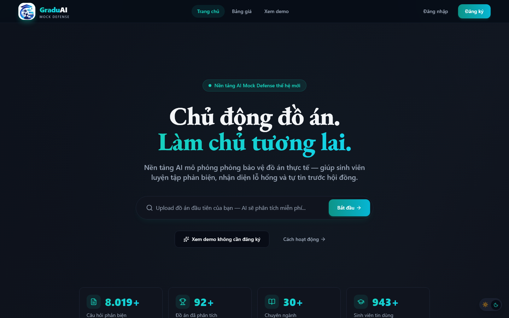
  
Hình 1.1: Giao diện Trang chủ nền tảng DefendAI

---

## 1.2 Ma trận phân quyền 3 vai trò (Roles & Permissions)

DefendAI phân định rành mạch thẩm quyền và trách nhiệm của từng nhóm người dùng:

| Tính năng cốt lõi | Sinh viên (Student) | Cố vấn (Mentor) | Quản trị viên (Admin) |
| :--- | :---: | :---: | :---: |
| Quản lý Workspace & Đề tài cá nhân | ✅ Toàn quyền | 👁️ Xem khi được mời | 👁️ Quản lý giám sát |
| Upload Đồ án & AI Code Review | ✅ Sử dụng | 👁️ Nhận xét / Đánh giá | ⚙️ Cấu hình Engine |
| Sinh câu hỏi phản biện AI | ✅ Tạo & Sinh lại | 👁️ Góp ý / Bổ sung | ⚙️ Cấu hình Prompt |
| Phòng bảo vệ giả lập (Mock Room AI) | ✅ Thực hành | ❌ (Có phòng riêng) | ❌ |
| Phòng bảo vệ Mentor (1-on-1 Session) | ✅ Đặt lịch & Tham gia | ✅ Chủ trì & Chấm điểm | 👁️ Tra cứu Log |
| Xuất "Bệnh án đồ án" (Report PDF) | ✅ Tải về | ✅ Nhập nhận xét | 👁️ Xem lịch sử |
| Quản lý Ví & Rút tiền hoa hồng | ❌ | ✅ Tạo yêu cầu | ✅ Đối soát & Duyệt |
| Quản lý Users & Cấu hình AI Provider | ❌ | ❌ | ✅ Toàn quyền |

---

## 1.3 Đăng ký, Đăng nhập & Xác thực

### Quy trình đăng nhập
1. Truy cập đường dẫn: `/login`.
2. Nhập thông tin **Email** và **Mật khẩu** đã đăng ký.
3. Nhấp chọn **"Đăng nhập"** hoặc sử dụng tùy chọn **"Đăng nhập với Google"**.
4. Hệ thống tự động phân loại quyền và điều hướng đến Dashboard tương ứng:
   - *Sinh viên:* Điều hướng đến `/documents` hoặc `/workspaces`.
   - *Mentor:* Điều hướng đến `/mentor/dashboard`.
   - *Admin:* Xuất hiện biểu tượng menu Quản trị và truy cập `/admin`.

  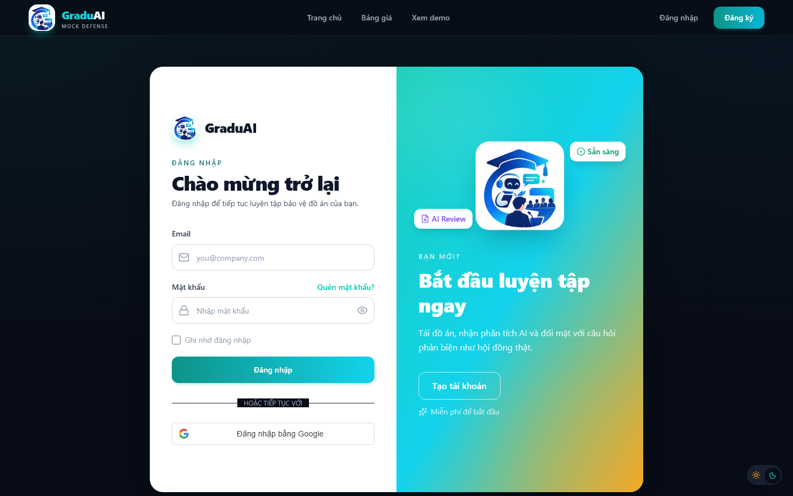
  
Hình 1.2: Màn hình Đăng nhập / Đăng ký tài khoản DefendAI

  <strong>Mẹo bảo mật:</strong> Nếu sử dụng thiết bị công cộng, bạn không nên tích chọn <em>"Ghi nhớ đăng nhập"</em> và hãy luôn đăng xuất khỏi hệ thống sau khi kết thúc phiên luyện tập.

---

## 1.4 Khám phá Bảng giá & Các gói dịch vụ

DefendAI cung cấp các gói dịch vụ linh hoạt phù hợp với nhu cầu từ ôn luyện cơ bản đến tăng tốc cấp tốc trước ngày bảo vệ chính thức:

  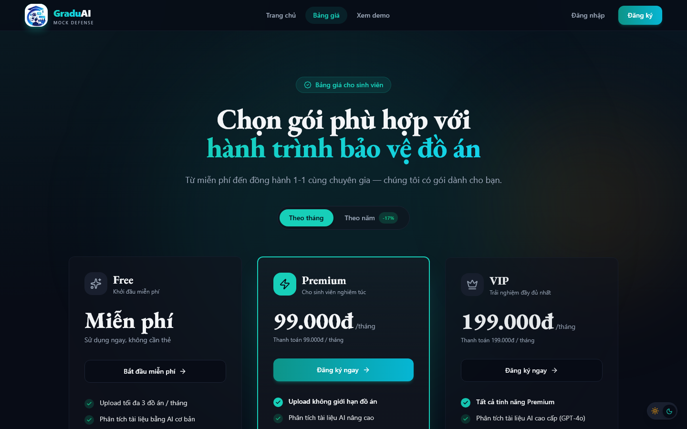
  
Hình 1.3: Giao diện Bảng giá và Gói dịch vụ thành viên

- **Gói Miễn phí (Free Starter):** Thích hợp trải nghiệm thử — 1 lần Code Review, 1 bộ câu hỏi cơ bản, 1 lượt Mock Room AI ngắn.
- **Gói Chuẩn (Standard Defense):** Phổ biến nhất — Không giới hạn Code Review, mở khóa toàn bộ Persona phản biện nâng cao và xuất file Bệnh án PDF hoàn chỉnh.
- **Gói Cố vấn Chuyên sâu (Pro Mentoring):** Toàn bộ quyền lợi gói Chuẩn cộng thêm các buổi 1-on-1 trực tiếp cùng giảng viên/chuyên gia đầu ngành.

---

# CHƯƠNG 2: HƯỚNG DẪN DÀNH CHO SINH VIÊN (STUDENT ROLE)

## 2.1 Quản lý Không gian làm việc (Workspaces & Đề tài)

Không gian làm việc (*Workspace*) là nơi lưu trữ toàn bộ tiến trình ôn luyện, tài liệu, mã nguồn và lịch sử các lần thi thử của một đề tài đồ án cụ thể.

  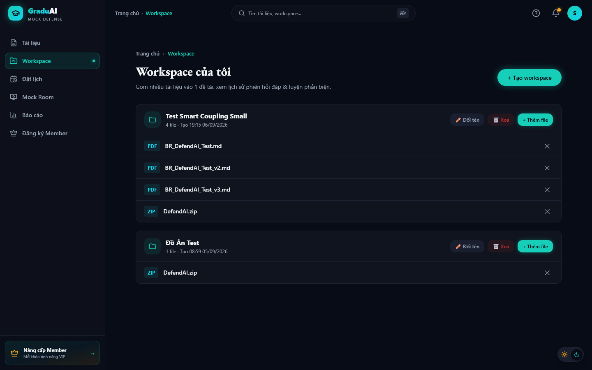
  
Hình 2.1: Danh sách Không gian làm việc của Sinh viên

### Các thao tác chính:
- **Tạo Workspace mới:** Nhấp chọn nút **"➕ Tạo Workspace mới"**, nhập tên đề tài, chuyên ngành (SE, IA, AI, IS...) và mô tả ngắn.
- **Truy cập Workspace:** Nhấp vào thẻ đồ án tương ứng để tiếp tục làm việc.
- **Trò chuyện đề tài (Chat đề tài):** Sử dụng trợ lý AI chuyên biệt để thảo luận về kiến trúc dự án, công nghệ sử dụng và nhận định sơ bộ trước khi nộp.

---

## 2.2 Tải lên & Quản lý Tài liệu Đồ án (PDF / DOCX)

Tài liệu đồ án là cơ sở dữ liệu quan trọng nhất để AI đọc hiểu nghiệp vụ, các biểu đồ ca sử dụng (Use Case), sơ đồ cơ sở dữ liệu và yêu cầu phi chức năng.

  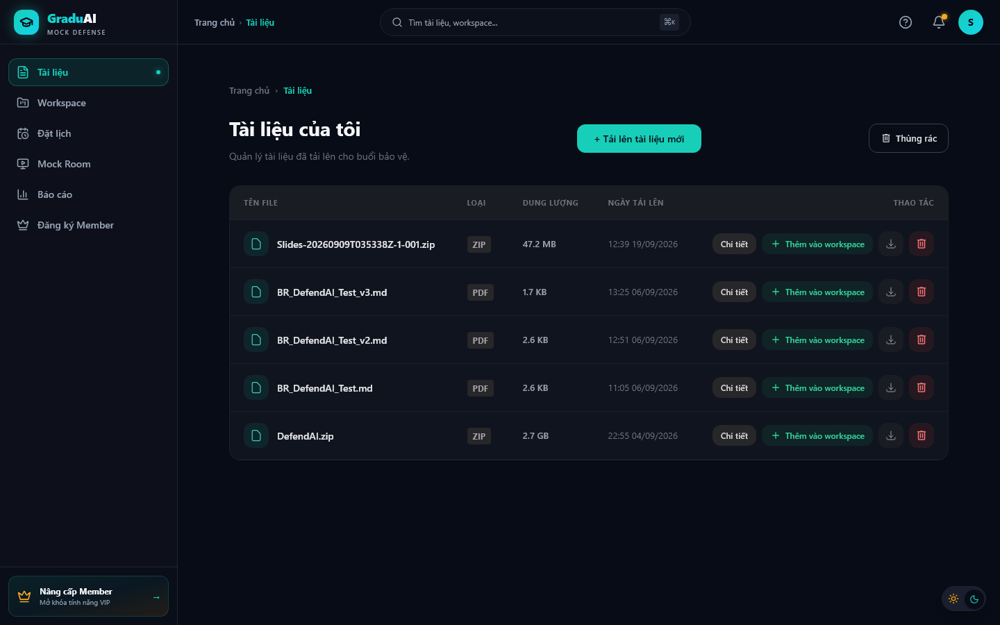
  
Hình 2.2: Khu vực Tải lên & Quản lý Tài liệu Đồ án

### Hướng dẫn tải tệp:
1. Truy cập menu **"Tài liệu"** (`/documents`).
2. Kéo thả hoặc bấm chọn tệp tài liệu đồ án của bạn (định dạng hỗ trợ: `.pdf`, `.docx`, dung lượng tối đa 50MB).
3. Hệ thống sẽ tiến hành bóc tách văn bản, trích xuất cấu trúc chương mục và hiển thị trạng thái xử lý:
   - 🟡 **Đang xử lý (Processing):** AI đang phân tích nội dung.
   - 🟢 **Sẵn sàng (Ready):** Đã phân tích xong, sẵn sàng sinh câu hỏi và phản biện.
   - 🔴 **Lỗi (Failed):** Tệp bị lỗi định dạng hoặc khóa mật khẩu.

  <strong>Lưu ý:</strong> Vui lòng không upload tài liệu chỉ chứa slide tóm tắt quá ngắn hoặc tài liệu scan dạng ảnh không có lớp ký tự (OCR text layer). Tệp cần có mục lục và nội dung chi tiết từ 30 trang trở lên để AI đạt độ chính xác cao nhất.

---

## 2.3 Đánh giá chất lượng Mã nguồn (AI Code Review)

Tính năng **AI Code Review** hỗ trợ sinh viên nộp toàn bộ source code của đồ án dưới dạng nén `.zip` hoặc `.rar` để rà soát lỗi bảo mật, vi phạm Clean Architecture, vi phạm quy ước đặt tên và các rủi ro kỹ thuật.

  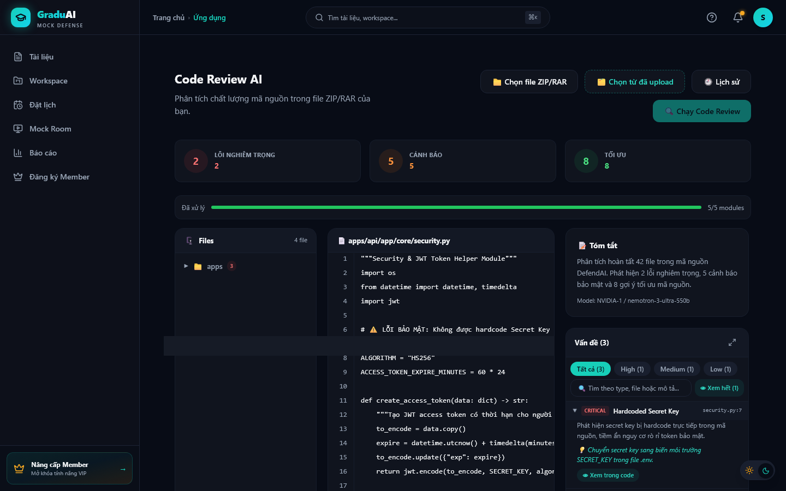
  
Hình 2.3: Bàn làm việc phân tích mã nguồn AI Code Review

### Cách sử dụng:
1. Truy cập trang **"Code Review"** (`/code-review`).
2. Nhấp nút **"Chọn file ZIP/RAR"** để tải mã nguồn dự án lên.
3. Bấm **"🔍 Chạy Code Review"** để kích hoạt tiến trình rà soát.
4. **Bố cục giao diện 3 cột trực quan:**
   - **Cột trái (File Tree):** Cây thư mục dự án, hiển thị biểu tượng cảnh báo màu đỏ/vàng cạnh các tệp chứa vấn đề.
   - **Cột giữa (Code Preview):** Trình xem mã nguồn với đánh số dòng và đánh dấu chính xác dòng bị vi phạm.
   - **Cột phải (Danh sách Vấn đề - Issues):** Bộ lọc theo mức độ nghiêm trọng:
     - 🔴 **CRITICAL / HIGH:** Lỗ hổng bảo mật nghiêm trọng (SQL Injection, lộ secret key, hardcode password).
     - 🟠 **MEDIUM / WARNING:** Vi phạm kiến trúc, thiếu validate dữ liệu, tiềm ẩn leak bộ nhớ.
     - 🔵 **LOW / OPTIMIZATION:** Gợi ý tối ưu hiệu năng, cải thiện Clean Code.

---

## 2.4 Sinh Bộ câu hỏi phản biện bảo vệ (AI Question Generation)

Dựa trên tài liệu đồ án và mã nguồn đã phân tích, hệ thống tự động sinh ra bộ 10 câu hỏi phản biện mô phỏng chính xác các góc độ chất vấn của Hội đồng chấm tốt nghiệp.

  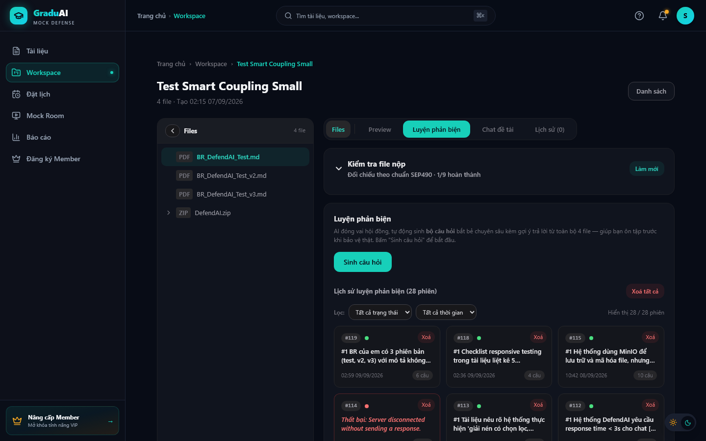
  
Hình 2.4: Danh sách câu hỏi phản biện chuyên sâu kèm phân loại

### Đặc điểm bộ câu hỏi:
- **Phân loại độ khó:** Dễ (Hiểu nghiệp vụ cơ bản), Trung bình (Kiến trúc & Công nghệ), Khó (Khả năng chịu tải, Bảo mật & Xử lý tình huống biên).
- **Xem gợi ý trả lời (Guideline):** Mỗi câu hỏi đều đi kèm dàn ý hướng dẫn trả lời, trích dẫn số trang tài liệu liên quan giúp sinh viên tra cứu nhanh.
- **Tính năng Sinh lại (Regenerate):** Nếu muốn đổi góc nhìn phản biện hoặc tập trung vào một chương cụ thể, bạn có thể bấm **"🔄 Sinh lại câu hỏi"**.

---

## 2.5 Phòng phản biện thử nghiệm (Mock Defense Room)

Đây là tính năng độc quyền cho phép bạn bước vào phòng bảo vệ giả định trực tuyến với Hội đồng Giám khảo AI.

  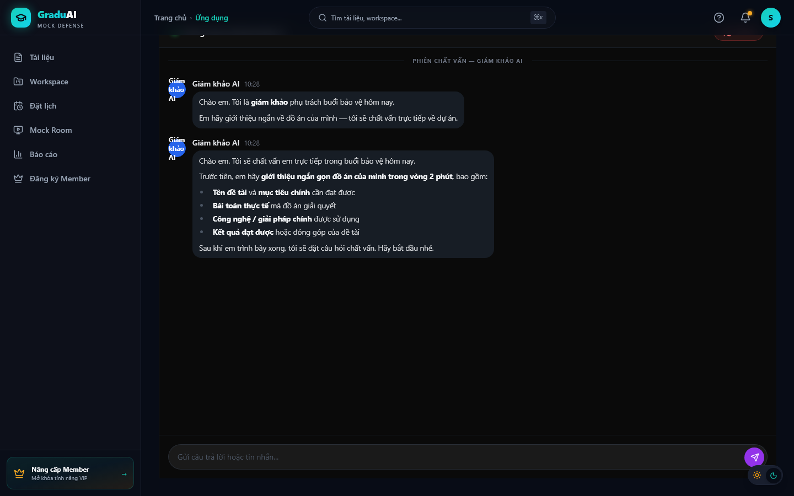
  
Hình 2.5: Giao diện Phòng bảo vệ giả định (Mock Defense Room)

### Quy trình diễn tập:
1. **Kiểm tra thiết bị:** Bật Micro và Camera trên trình duyệt khi có thông báo cấp quyền.
2. **Chọn Persona Hội đồng:** Chọn phong cách giám khảo (Khắt khe - Chuyên gia Kỹ thuật, Tỉ mỉ - Chuyên gia Nghiệp vụ kinh doanh, Thân thiện - Động viên).
3. **Thuyết trình đồ án (Presentation):** Sinh viên có 10-15 phút trình bày slide tóm tắt đề tài.
4. **Hỏi & Đáp (Q&A Session):** Giám khảo AI sẽ đặt câu hỏi bằng giọng nói tự nhiên, sinh viên trả lời trực tiếp qua mic. Hệ thống tự động ghi âm và chuyển đổi thành văn bản (Speech-to-Text).
5. **Kết thúc phiên:** Nhấp **"Hoàn thành bảo vệ"** để hệ thống tổng hợp dữ liệu chấm điểm.

---

## 2.6 Tra cứu Báo cáo & Xuất "Bệnh án đồ án" (Report PDF)

Sau khi hoàn tất phiên bảo vệ giả định, hệ thống lập tức xuất Báo cáo Đánh giá Chi tiết (còn gọi là *"Bệnh án đồ án"*).

  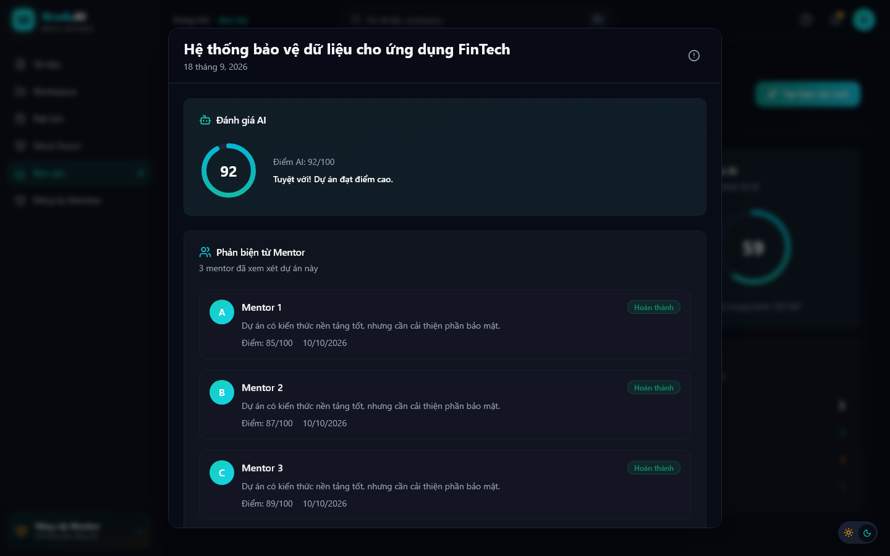
  
Hình 2.6: Báo cáo Bệnh án đồ án và Bảng điểm năng lực CLO

### Các chỉ số then chốt:
- **Điểm OGA (Oral Grading Assessment):** Đánh giá năng lực thuyết trình, phản xạ trả lời, độ tự tin và tính lưu loát.
- **Điểm TDA (Technical Documentation Assessment):** Đánh giá chất lượng văn bản, sơ đồ thiết kế và độ hoàn thiện mã nguồn.
- **Bảng điểm 7 Chuẩn đầu ra (CLO / SEP490):** Thể hiện chi tiết từng kỹ năng: Phân tích yêu cầu, Thiết kế hệ thống, Hiện thực hóa mã nguồn, Kiểm thử, Quản lý dự án, Kỹ năng giao tiếp và Đạo đức nghề nghiệp.
- **Nút "Xuất PDF":** Tải toàn bộ hồ sơ bệnh án về máy tính để gửi cho giảng viên hướng dẫn xem xét.

---

## 2.7 Đặt lịch hẹn cố vấn chuyên sâu (Bookings)

Nếu sinh viên cần được giảng viên hoặc chuyên gia đầu ngành cố vấn trực tiếp 1-on-1 để hoàn thiện đồ án trước kỳ thi chính thức:

  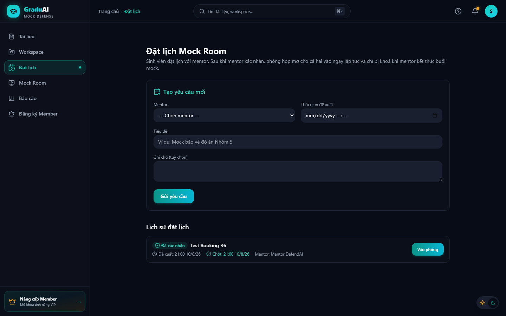
  
Hình 2.7: Màn hình Đặt lịch hẹn Cố vấn chuyên môn

1. Truy cập mục **"Lịch hẹn"** (`/bookings`).
2. Xem danh sách các Mentor phù hợp theo chuyên ngành (Web, Mobile, AI/ML, DevOps, Security).
3. Chọn khung giờ rảnh mong muốn trên lịch của Mentor và xác nhận đặt lịch.
4. Tham gia buổi tư vấn trực tuyến vào thời gian đã hẹn.

---

# CHƯƠNG 3: HƯỚNG DẪN DÀNH CHO CỐ VẤN / GIẢNG VIÊN (MENTOR ROLE)

## 3.1 Tổng quan Bảng điều khiển Mentor (Dashboard)

Khi đăng nhập với tài khoản có vai trò **Mentor**, giảng viên được điều hướng đến Trung tâm Điều hành Chuyên môn (`/mentor/dashboard`).

  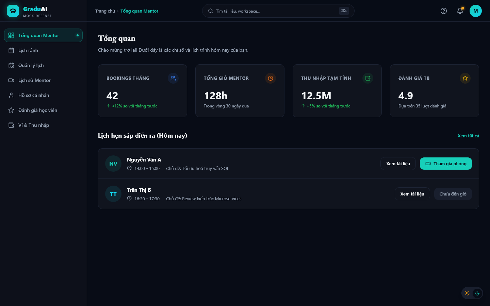
  
Hình 3.1: Bảng điều khiển trung tâm dành cho Mentor

### Các khối thông tin quan trọng:
- **Tổng số phiên đã hướng dẫn:** Số lượt sinh viên đã hoàn thành buổi tư vấn.
- **Đánh giá trung bình (Rating):** Điểm phản hồi từ các nhóm sinh viên.
- **Số dư khả dụng trong ví:** Thu nhập có thể tạo lệnh rút về tài khoản ngân hàng.
- **Lịch hẹn sắp tới:** Danh sách các phiên tư vấn sắp diễn ra trong ngày/tuần.

---

## 3.2 Quản lý Phiên hướng dẫn (Sessions & Meetings)

Mục **"Quản lý phiên hướng dẫn"** (`/mentor/sessions`) lưu trữ toàn bộ lịch sử các buổi phản biện và tư vấn đồ án.

  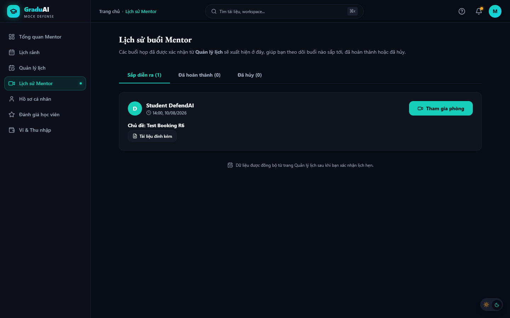
  
Hình 3.2: Danh sách các phiên hướng dẫn của Mentor

- **Chuẩn bị trước phiên:** Mentor có thể mở xem trước tệp tài liệu đồ án và kết quả Code Review do AI đã phân tích của nhóm sinh viên đó.
- **Vào phòng họp:** Nhấp **"Vào phòng"** tại thời điểm diễn ra buổi hẹn để kết nối trực tiếp với sinh viên qua phòng Video Call tích hợp.
- **Ghi chú & Nhận xét:** Nhập các lưu ý chuyên môn trong suốt phiên làm việc.

---

## 3.3 Thiết lập Lịch rảnh & Tiếp nhận yêu cầu (Calendar & Bookings)

Để sinh viên có thể chủ động đặt lịch tư vấn, Mentor cần cấu hình các khung giờ khả dụng trong tuần.

  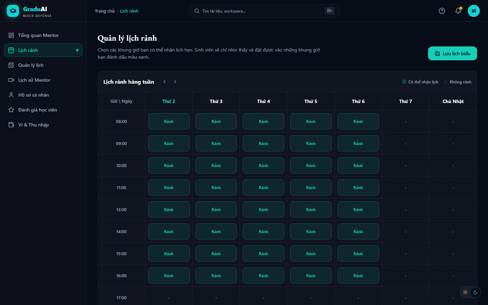
  
Hình 3.3: Giao diện Lịch làm việc và Thiết lập khung giờ rảnh

1. Truy cập **"Lịch làm việc"** (`/mentor/calendar`).
2. Chọn các ngày trong tuần và nhấp để bật/tắt các slot giờ rảnh (Ví dụ: 19:00 - 20:00, 20:30 - 21:30).
3. Khi sinh viên đăng ký một khung giờ, hệ thống sẽ tự động gửi thông báo xác nhận và khóa khung giờ đó trên lịch.

---

## 3.4 Quản lý Ví thu nhập & Yêu cầu rút tiền (Wallet & Payout)

Toàn bộ chi phí thù lao hướng dẫn sau mỗi phiên hoàn thành sẽ được cộng trực tiếp vào ví của Mentor sau khi khấu trừ phí dịch vụ nền tảng.

  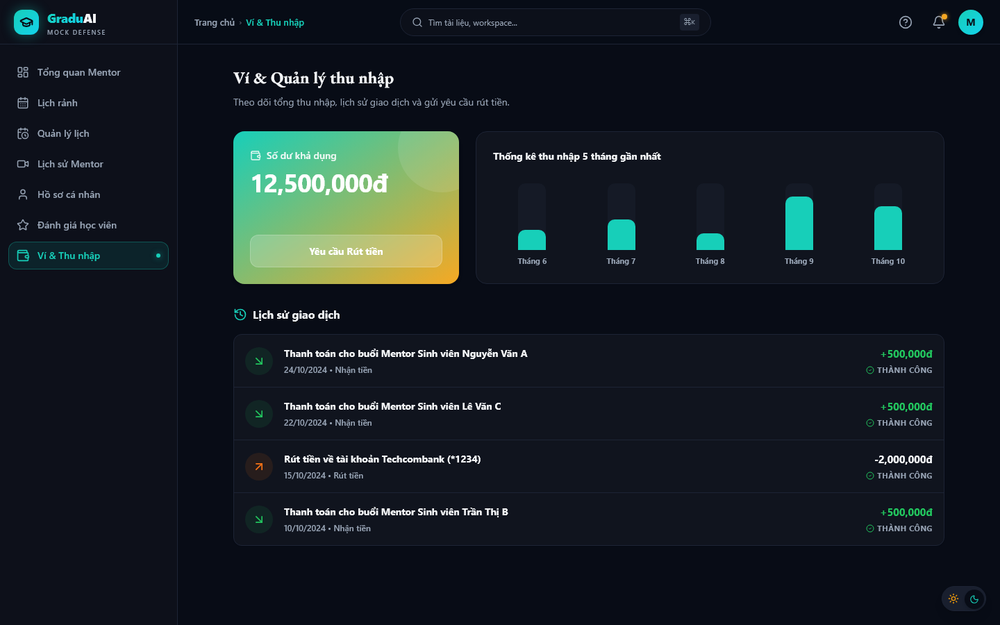
  
Hình 3.4: Giao diện Ví thu nhập và Lịch sử giao dịch của Mentor

### Quy trình tạo yêu cầu rút tiền:
1. Truy cập mục **"Ví cá nhân"** (`/mentor/wallet`).
2. Kiểm tra **Số dư khả dụng**.
3. Nhập số tiền cần rút (tối thiểu 200.000 VNĐ).
4. Điền thông tin tài khoản ngân hàng thụ hưởng (Tên ngân hàng, Số tài khoản, Tên chủ thẻ).
5. Nhấp **"Gửi yêu cầu rút tiền"**. Yêu cầu sẽ được chuyển đến Bộ phận Tài chính (Admin) để duyệt trong vòng 24 giờ làm việc.

---

# CHƯƠNG 4: HƯỚNG DẪN DÀNH CHO QUẢN TRỊ VIÊN (ADMIN ROLE)

## 4.1 Bảng điều khiển Tổng quan Vận hành (Overview Dashboard)

Trang Tổng quan Quản trị (`/admin`) cung cấp cái nhìn toàn cảnh thời gian thực về sức khỏe và hiệu suất hoạt động của toàn bộ hệ thống DefendAI.

  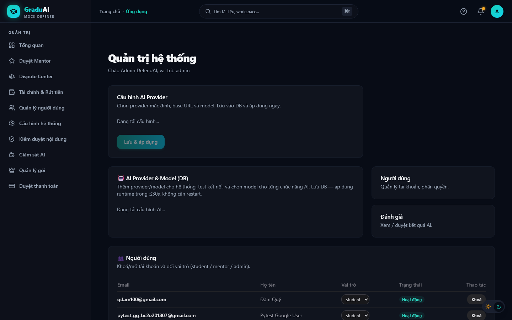
  
Hình 4.1: Bảng điều khiển Tổng quan Vận hành Nền tảng (Admin Dashboard)

### Các chỉ số điều hành then chốt:
- **Tổng doanh thu nền tảng:** Doanh thu gộp từ các gói thành viên và hoa hồng dịch vụ cố vấn.
- **Người dùng hoạt động (Active Users):** Lượng sinh viên và giảng viên truy cập trong kỳ bảo vệ.
- **Tổng phiên bảo vệ đã hoàn thành:** Số lượng đồ án đã được kiểm thử qua Mock Room và Mentoring.
- **Biểu đồ tăng trưởng:** Phân bổ người dùng theo chuyên ngành và lưu lượng sử dụng dịch vụ.

---

## 4.2 Quản trị Người dùng & Phân quyền (User Management)

Khu vực **"Quản lý Người dùng"** (`/admin/users`) cho phép Admin kiểm soát toàn bộ danh sách tài khoản trong cơ sở dữ liệu.

  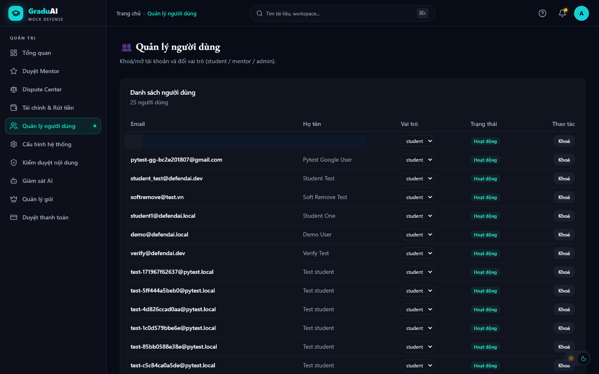
  
Hình 4.2: Danh sách Người dùng và Công cụ Phân quyền Quản trị

- **Tìm kiếm & Lọc:** Tra cứu nhanh người dùng theo Email, Tên đầy đủ, hoặc Vai trò (Student, Mentor, Admin).
- **Phân quyền vai trò:** Cấp quyền hoặc thu hồi quyền Mentor/Admin.
- **Khóa tài khoản:** Tạm khóa tài khoản trong trường hợp vi phạm quy chế hoặc gian lận học thuật.

---

## 4.3 Thẩm định & Phê duyệt Hồ sơ Mentor (Mentor Verification)

Để đảm bảo chất lượng chuyên môn cao nhất cho đội ngũ cố vấn trên sàn, tất cả hồ sơ Mentor đăng ký mới đều phải trải qua quy trình xác minh nghiêm ngặt.

  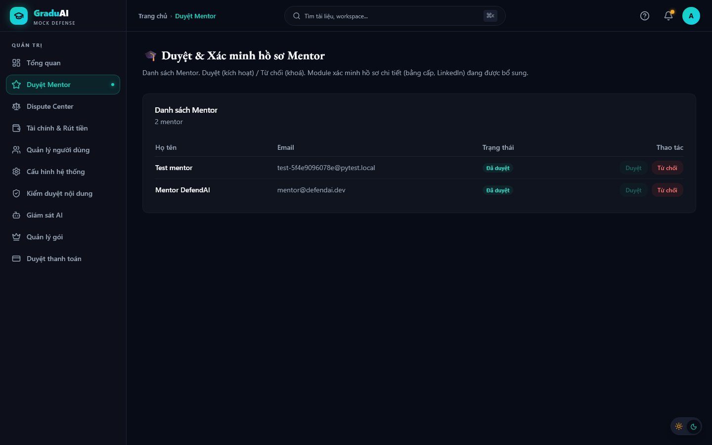
  
Hình 4.3: Trung tâm Duyệt và Xác minh Hồ sơ Cố vấn mới

### Các bước thẩm định của Admin:
1. Kiểm tra bằng cấp chuyên môn, chứng chỉ kỹ thuật, hồ sơ LinkedIn và kinh nghiệm hướng dẫn đồ án.
2. **Phê duyệt (Approve):** Nhấp `Approve` để kích hoạt vai trò Mentor công khai trên hệ thống.
3. **Từ chối (Reject):** Chọn lý do từ chối (thiếu chứng chỉ, thông tin không chính xác) để hệ thống gửi email phản hồi yêu cầu bổ sung.

---

## 4.4 Trung tâm Hòa giải Khiếu nại (Dispute Center)

Khi có tranh chấp phát sinh giữa Sinh viên và Mentor (ví dụ: vắng mặt không lý do, hủy lịch muộn, sự cố đường truyền mạng), Ticket khiếu nại sẽ được đưa về **Dispute Center** (`/admin/dispute`).

  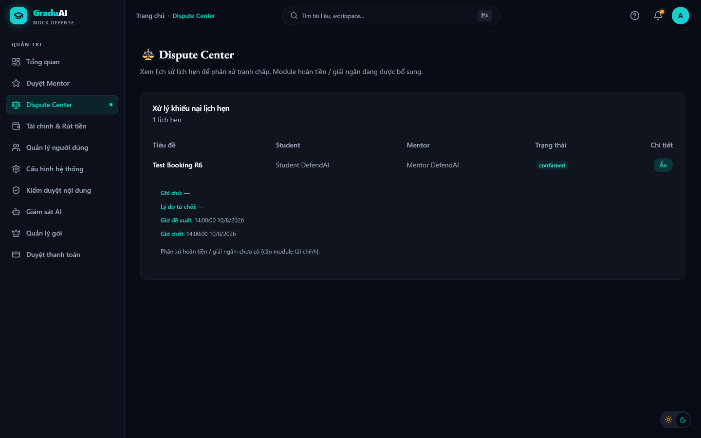
  
Hình 4.4: Bàn làm việc Phân xử Khiếu nại & Tranh chấp lịch hẹn

### Thẩm quyền xử lý của Admin:
- **Lỗi do Mentor:** Hoàn tiền 100% cho sinh viên, gửi cảnh báo hoặc trừ điểm uy tín của Mentor.
- **Lỗi do Sinh viên:** Duyệt giải ngân chi phí buổi học cho Mentor nếu sinh viên không tham gia không báo trước.
- **Sự cố kỹ thuật:** Tặng voucher đền bù buổi học khác và chuyển ticket cho bộ phận phát triển.

---

## 4.5 Đối soát Tài chính & Duyệt Lệnh Rút tiền (Payout Settlement)

Màn hình **Đối soát & Rút tiền** (`/admin/payout`) đảm bảo dòng tiền trên sàn minh bạch và tuân thủ các quy tắc tài chính.

  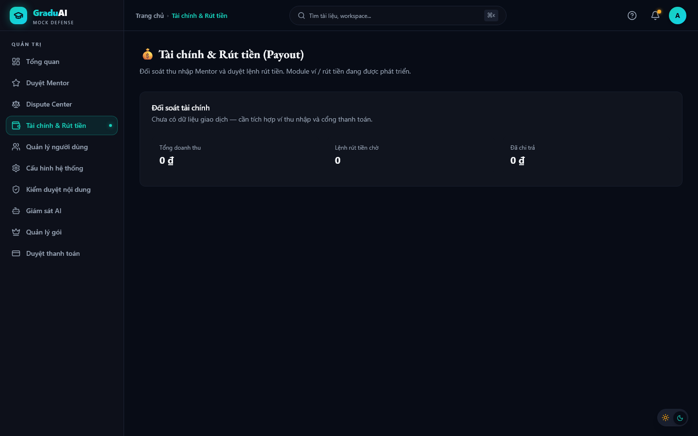
  
Hình 4.5: Danh sách Lệnh rút tiền và Bảng đối soát tài chính

1. Admin đối chiếu số dư khả dụng với số phiên học thực tế đã hoàn thành.
2. Kiểm tra thông tin tài khoản ngân hàng thụ hưởng của Mentor.
3. Nhấp **"Duyệt chi trả"** (`Approve Payout`) để hoàn tất thanh toán.

---

## 4.6 Cấu hình Tham số Hệ thống & AI Gateway (System Settings)

Trang Cấu hình (`/admin/settings`) cho phép Super Admin điều chỉnh các tham số vận hành cốt lõi của nền tảng:

  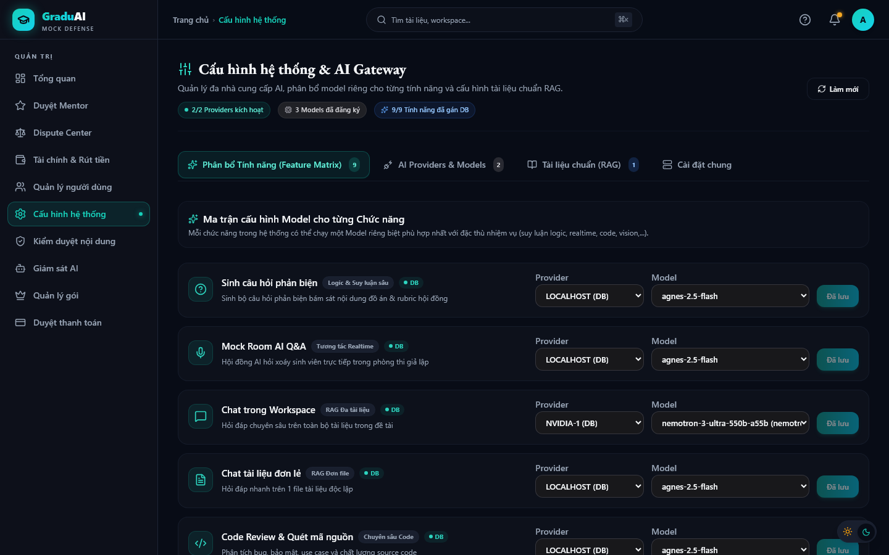
  
Hình 4.6: Giao diện Cấu hình Tham số Hệ thống & AI Gateway

- **Quản lý AI Providers:** Thêm mới, thay đổi API Key, Base URL của các nhà cung cấp mô hình (OpenAI, Gemini, NVIDIA NIM, OpenRouter).
- **Chỉ định Model theo tính năng:** Gán model tối ưu riêng cho từng module (VD: `gpt-4o` cho Question Gen, `deepseek-coder` cho Code Review, `nemotron` cho Speech Defense).
- **Tỷ lệ hoa hồng sàn:** Thiết lập phần trăm chiết khấu hoa hồng trên mỗi phiên cố vấn.

---

# CHƯƠNG 5: GIẢI ĐÁP THẮC MẮC & XỬ LÝ SỰ CỐ (FAQ & TROUBLESHOOTING)

### ❓ 1. Tôi tải tệp ZIP mã nguồn lên nhưng hệ thống báo "File này không được xác định là source code"?
- **Nguyên nhân:** Tệp ZIP của bạn chỉ chứa các tệp văn bản (Word, PDF) hoặc tệp nén rỗng, không chứa các định dạng mã nguồn tiêu chuẩn (`.java`, `.cs`, `.py`, `.ts`, `.cpp`...).
- **Khắc phục:** Nén trực tiếp thư mục `src/` của dự án và loại bỏ các thư mục rác như `node_modules/`, `bin/`, `obj/`, `target/` để giảm dung lượng.

### ❓ 2. Tôi có thể đổi người cố vấn (Mentor) sau khi đã đặt lịch hẹn không?
- Bạn có thể hủy lịch hẹn trước ít nhất **12 tiếng** so với giờ hẹn để được hoàn 100% số dư vào tài khoản và chủ động chọn Mentor khác. Hủy trong vòng 12 tiếng sẽ áp dụng chính sách hoàn phí một phần theo quy định.

### ❓ 3. Trong phòng Mock Room, nếu AI không nghe thấy giọng của tôi thì phải làm sao?
- Kiểm tra quyền truy cập Micro trên thanh địa chỉ của trình duyệt (nhấp biểu tượng ổ khóa 🔒 bên cạnh URL và chọn Cho phép Micro).
- Đảm bảo thiết bị thu âm mặc định trên hệ điều hành đang hoạt động tốt.

### ❓ 4. Bệnh án đồ án xuất file PDF có giá trị pháp lý chính thức không?
- File "Bệnh án đồ án" là tài liệu chẩn đoán học thuật mang tính chất định hướng và tự đánh giá dựa trên thang chuẩn đầu ra (CLO / SEP490). Kết quả thi tốt nghiệp chính thức vẫn phụ thuộc vào quyết định của Hội đồng chấm thi tại trường đại học của bạn.

---

  <strong>Kênh hỗ trợ kỹ thuật chính thức:</strong> 
  📧 Email: <code>support@defendai.dev</code> | 🌐 Website: <code>https://defend-ai.vercel.app</code> 
  🛡️ <em>DefendAI — Vững bước bảo vệ, tự tin tốt nghiệp!</em>

